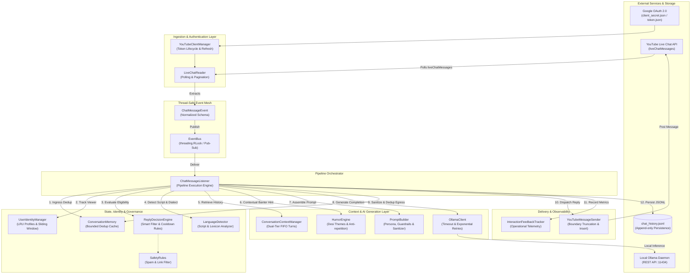
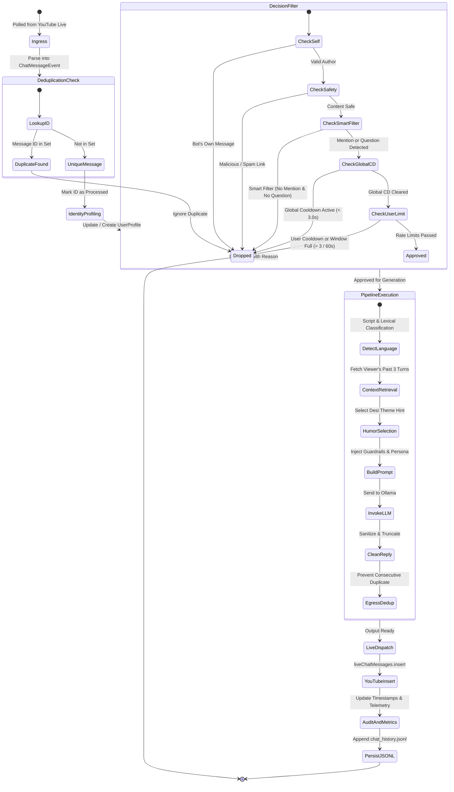
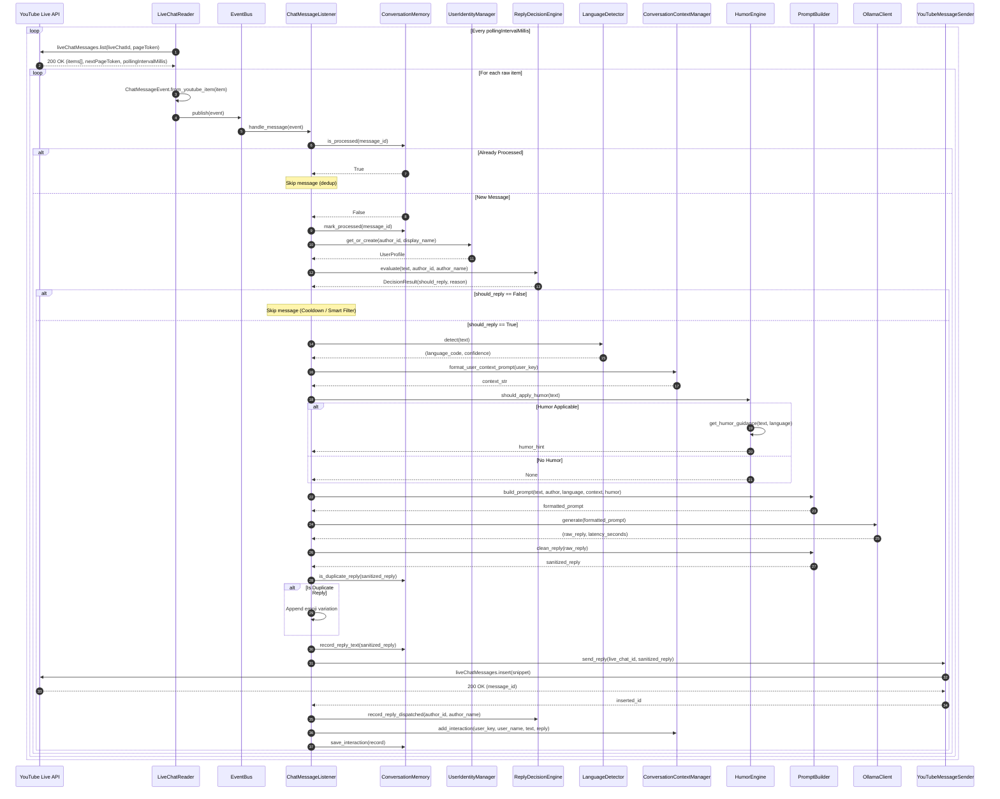

# 🧠 ChatBrain — Local AI YouTube Live Chat Assistant

ChatBrain is a local AI-powered chatbot designed to automatically interact with viewers on YouTube Live Chat. Powered by local LLMs via **Ollama**, it provides natural, friendly, and culturally nuanced (Desi/Marathi/Hindi/Hinglish/English) live replies while running 100% locally on your machine with zero external AI API costs.

---

## 🌟 Key Features

- **Local AI Inference**: Powered by local Ollama models (default: `llama3.2:latest`) — no OpenAI, Anthropic, or paid cloud AI API keys required.
- **Multilingual & Script-Aware**: Dynamically detects and responds in the viewer's language and script:
  - Marathi (Devanagari: मराठी & Roman: e.g. *kay chalalay bhava*)
  - Hindi (Devanagari: हिंदी)
  - Hinglish (Roman Hindi: e.g. *kya haal hai bhai*)
  - English
- **Natural Desi Personality**: Stream-tailored conversational tone featuring friendly banter, Kolhapur/Maharashtra touches, and BCA/coding life tropes.
- **Modular Event-Driven Architecture**: Decoupled message reader, normalization, duplicate filter, reply decision engine, context manager, and YouTube dispatcher.
- **API Quota & Rate-Limit Protection**: 
  - YouTube-mandated polling interval adherence.
  - Global reply cooldown (configurable).
  - Per-user rate-limiting and sliding window cooldown.
  - Duplicate message filtering and duplicate reply prevention.
- **Smart Reply Filtering**: Only processes questions or direct mentions (`@chatbrain`) during busy streams, saving API quota.
- **Isolated Conversation Memory**: Maintains short-term conversational context per viewer for natural follow-ups without context bleed between viewers.
- **Streamlit Replay Dashboard**: Real-time interface to inspect live chats, model responses, delivery status, and operational metrics.
- **Windows Launcher**: Simple `.cmd` scripts with automatic virtual environment detection.

---

## 🏗️ Architecture & Processing Pipeline

### Directory Structure

```text
chat-brain/
├── main.py                     # Unified CLI entry point & health check
├── app.py                      # Streamlit dashboard launcher
├── brain.py                    # Backwards-compatible AI response generator
├── youtube.py                  # Backwards-compatible YouTube integration
├── config/
│   ├── __init__.py
│   └── settings.py             # Centralized settings & environment loading
├── youtube/
│   ├── __init__.py
│   ├── client.py               # OAuth 2.0 lifecycle & service builder
│   ├── live_chat_reader.py     # Live broadcast finder, message polling & pagination
│   └── message_sender.py       # Message truncation & YouTube liveChat insert
├── events/
│   ├── __init__.py
│   ├── base_event.py           # Base event dataclass
│   ├── chat_message_event.py   # Normalized chat message event
│   └── event_bus.py            # Thread-safe pub/sub event dispatcher
├── listeners/
│   ├── __init__.py
│   └── chat_message_listener.py# Event listener orchestrating response pipeline
├── context/
│   ├── __init__.py
│   └── conversation_context.py # Per-user & stream-wide bounded conversation turns
├── identity/
│   ├── __init__.py
│   └── user_identity.py        # Stable channel tracking, bot self-check & cooldowns
├── decision/
│   ├── __init__.py
│   ├── reply_decision.py       # Reply eligibility, mention & question evaluation
│   └── safety_rules.py         # Spam prevention, link filters & blocked keywords
├── comedy/
│   ├── __init__.py
│   └── humor_engine.py         # Light desi humor hints & anti-repetition tracker
├── memory/
│   ├── __init__.py
│   └── conversation_memory.py  # Bounded deduplication cache & JSONL persistence
├── learning/
│   ├── __init__.py
│   └── interaction_feedback.py # Operational telemetry & latency tracker
├── llm/
│   ├── __init__.py
│   ├── ollama_client.py        # Reusable Ollama client with health check & retry
│   └── prompt_builder.py       # Persona prompt generator & output sanitizer
├── dashboard/
│   ├── __init__.py
│   └── app.py                  # Streamlit visual dashboard
├── utils/
│   ├── __init__.py
│   ├── logger.py               # Sanitized structured logging (token masking)
│   └── language_detector.py    # Lightweight script & lexical language detector
├── requirements.txt            # Python dependencies
├── .env.example                # Configuration template
├── start_chatbrain.cmd         # Windows launcher with virtualenv auto-detection
├── run_chatbrain.cmd           # Alternate Windows launcher
└── README.md
```

### Event-Driven Pipeline Flow

```text
YouTube Live Stream
        ↓
[LiveChatReader] (Polls liveChatMessages.list respecting quota interval)
        ↓
[ChatMessageEvent] (Normalized with author ID, display name, text, metadata)
        ↓
[EventBus] (Dispatches to registered subscribers)
        ↓
[ChatMessageListener]
        ↓
├── [ConversationMemory] (Check if message ID was already processed)
├── [UserIdentityManager] (Update viewer history; verify not bot's own message)
├── [ReplyDecisionEngine] (Check smart filter, question words, global & user cooldowns)
├── [LanguageDetector] (Identify Marathi Devanagari/Roman, Hindi, Hinglish, English)
├── [ConversationContextManager] (Retrieve recent context for this viewer)
├── [HumorEngine] (Determine if light banter/humor fits)
├── [PromptBuilder] (Assemble persona prompt + guardrails)
├── [OllamaClient] (Local inference via Ollama with retry & timeout protection)
├── [PromptBuilder.clean_reply] (Strip prefixes, deduplicate, limit length)
├── [YouTubeMessageSender] (Post text reply to YouTube Live Chat)
└── [ConversationMemory] (Save record to chat_history.jsonl)
```

---

## 📐 Low-Level Design (LLD)

This section details the Low-Level Design (LLD) for ChatBrain, specifying subsystem responsibilities, class interfaces, data contracts, concurrency semantics, rate-limiting algorithms, and fault-tolerance boundaries.





---

### 1. Architectural Patterns & Core Principles

ChatBrain employs the following design patterns:

1. **Event-Driven Publish-Subscribe**: Readers and downstream consumers are decoupled through [`EventBus`](file:///c:/Users/Shantanu/Desktop/chat-brain/events/event_bus.py#L16-L74), preventing network latency from blocking the ingestion thread.
2. **Pipeline Pattern**: Message processing is decomposed into discrete, testable filtering and transformation steps orchestrated by [`ChatMessageListener`](file:///c:/Users/Shantanu/Desktop/chat-brain/listeners/chat_message_listener.py#L28-L186).
3. **Inversion of Control & Dependency Injection**: Subsystems accept [`Settings`](file:///c:/Users/Shantanu/Desktop/chat-brain/config/settings.py#L20-L100) and collaborator instances via constructors, facilitating unit testing and mock injection.
4. **Bounded In-Memory Caching (LRU & FIFO)**: High-throughput live streams are protected against memory exhaustion through bounded `deque` and `OrderedDict` caches with automated eviction.
5. **Zero External AI Dependency**: 100% local inference executed via Ollama, safeguarding API keys and avoiding token fees.
6. **Graceful Degradation**: Fallback responses and exponential error backoffs ensure continuous operation despite API throttling or inference hiccups.

---

### 2. Class Diagram & Structural Relationships

```mermaid
classDiagram
    direction TB

    class BaseEvent {
        +str event_id
        +str event_type
        +float timestamp
    }

    class ChatMessageEvent {
        +str message_id
        +str author_id
        +str author_name
        +str text
        +str clean_text
        +str published_at
        +bool is_owner
        +bool is_moderator
        +bool is_sponsor
        +str detected_language
        +dict raw_item
        +from_youtube_item(item: dict)$ ChatMessageEvent
    }
    BaseEvent <|-- ChatMessageEvent

    class EventBus {
        -RLock _lock
        -dict _subscribers
        +subscribe(event_type, handler) void
        +unsubscribe(event_type, handler) void
        +publish(event: BaseEvent) void
    }

    class YouTubeClientManager {
        -Settings settings
        -Resource _service
        -str _channel_id
        -str _channel_title
        +get_service() Resource
        -_authenticate() Credentials
        +get_authenticated_channel_info() tuple
    }

    class LiveChatReader {
        -Resource service
        -Settings settings
        +str live_chat_id
        +str active_broadcast_title
        +str next_page_token
        +find_active_live_chat_id() str
        +fetch_messages() tuple
    }

    class YouTubeMessageSender {
        -Resource service
        -Settings settings
        +send_reply(live_chat_id: str, reply_text: str) str
    }

    class ConversationMemory {
        +str history_file
        +int max_cache_size
        -Lock _lock
        -set _processed_ids
        -deque _processed_order
        -deque _recent_replies
        +is_processed(message_id: str) bool
        +mark_processed(message_id: str) void
        +is_duplicate_reply(reply_text: str) bool
        +record_reply_text(reply_text: str) void
        +save_interaction(...) bool
        +load_recent_interactions(limit: int) list
    }

    class UserIdentityManager {
        +int max_users
        -OrderedDict _users
        +str bot_channel_id
        +list bot_display_names
        +set_bot_identity(channel_id, names) void
        +is_bot_self(user_id, display_name) bool
        +get_or_create(...) UserProfile
        +can_reply_to_user(...) tuple
        +record_reply_sent(user_id, display_name) void
    }

    class UserProfile {
        +str user_id
        +str display_name
        +float first_seen
        +float last_seen
        +int message_count
        +int reply_count
        +float last_reply_time
        +list reply_timestamps
        +bool is_owner
        +bool is_moderator
        +bool is_sponsor
    }
    UserIdentityManager o-- UserProfile

    class SafetyRules {
        +list blocked_keywords
        +is_safe(text: str) tuple
    }

    class DecisionResult {
        +bool should_reply
        +str reason
        +bool is_direct_mention
        +bool is_question
    }

    class ReplyDecisionEngine {
        -Settings settings
        -UserIdentityManager identity_manager
        -SafetyRules safety_rules
        +float last_global_reply_time
        +evaluate(text, author_id, author_name) DecisionResult
        +record_reply_dispatched(author_id, author_name) void
    }
    ReplyDecisionEngine --> DecisionResult
    ReplyDecisionEngine --> SafetyRules

    class ConversationContextManager {
        +int max_user_turns
        +int max_global_turns
        +int max_tracked_users
        -dict _user_contexts
        -deque _global_context
        +add_interaction(...) void
        +get_user_context(user_key) list
        +format_user_context_prompt(user_key) str
        +clear() void
    }

    class ConversationTurn {
        +str user_message
        +str bot_reply
        +float timestamp
        +str language
    }
    ConversationContextManager o-- ConversationTurn

    class HumorEngine {
        +bool enabled
        +float intensity
        -deque _recent_themes
        +should_apply_humor(message, is_technical) bool
        +get_humor_guidance(message, language) str
    }

    class LanguageDetector {
        +detect(text: str)$ tuple
        +clean_text(text: str)$ str
    }

    class PromptBuilder {
        -Settings settings
        +clean_message(message: str) str
        +build_prompt(...) str
        +clean_reply(reply: str) str
        +get_fallback_reply(language: str) str
    }

    class OllamaClient {
        -Settings settings
        +str base_url
        +str model_name
        +float temperature
        +float timeout
        +int max_retries
        +check_health() tuple
        +generate(prompt: str) tuple
    }

    class InteractionFeedbackTracker {
        -Lock _lock
        +float start_time
        +int messages_received
        +int messages_ignored
        +int replies_generated
        +int replies_sent
        +int replies_skipped
        +int processing_errors
        +float total_generation_time
        +record_received() void
        +record_ignored(reason) void
        +record_reply_generated(latency) void
        +record_reply_sent() void
        +record_reply_skipped(reason) void
        +record_error() void
        +get_summary() dict
    }

    class ChatMessageListener {
        -Settings settings
        -ConversationMemory memory
        -UserIdentityManager identity_manager
        -ReplyDecisionEngine decision_engine
        -ConversationContextManager context_manager
        -HumorEngine humor_engine
        -OllamaClient ollama_client
        -PromptBuilder prompt_builder
        -YouTubeMessageSender message_sender
        -InteractionFeedbackTracker feedback_tracker
        +str live_chat_id
        +handle_message(event: ChatMessageEvent) void
        +set_live_chat_id(live_chat_id: str) void
    }

    class ChatService {
        -Settings settings
        +bool running
        -int _consecutive_errors
        +initialize_pipeline() bool
        +start() void
        +stop() void
    }

    ChatService --> YouTubeClientManager
    ChatService --> LiveChatReader
    ChatService --> YouTubeMessageSender
    ChatService --> EventBus
    ChatService --> ChatMessageListener
    ChatMessageListener --> EventBus
    ChatMessageListener --> ConversationMemory
    ChatMessageListener --> UserIdentityManager
    ChatMessageListener --> ReplyDecisionEngine
    ChatMessageListener --> ConversationContextManager
    ChatMessageListener --> HumorEngine
    ChatMessageListener --> PromptBuilder
    ChatMessageListener --> OllamaClient
    ChatMessageListener --> LanguageDetector
    ChatMessageListener --> InteractionFeedbackTracker
```



---

### 3. Subsystem Specifications & Detailed Component Contracts

#### 3.1. Configuration Subsystem (`config/settings.py`)

- **Class**: [`Settings`](file:///c:/Users/Shantanu/Desktop/chat-brain/config/settings.py#L20-L163)
- **Role**: Validated container for all operational parameters.
- **Key Fields**:
  - `OLLAMA_BASE_URL` (`str`): Base URL for local Ollama server (default: `http://localhost:11434`).
  - `OLLAMA_MODEL` (`str`): Active model tag (default: `llama3.2:latest`).
  - `OLLAMA_TIMEOUT` (`float`): Inference timeout limit in seconds (default: `30.0`).
  - `SMART_REPLY_FILTER` (`bool`): Gatekeeper for only replying to questions or mentions during heavy stream chat.
  - `GLOBAL_REPLY_COOLDOWN_SECONDS` (`float`): Global pacing interval between any replies (default: `3.0`).
  - `USER_REPLY_COOLDOWN_SECONDS` (`float`): User-level pacing cooldown (default: `10.0`).
  - `MAX_REPLIES_PER_USER_WINDOW` (`int`): Maximum replies to the same user in a sliding window (default: `3` in `60.0s`).
  - `MAX_REPLY_LENGTH` (`int`): Maximum character length for YouTube Live Chat output (default: `200`).
  - `HUMOR_ENABLED` (`bool`) & `HUMOR_INTENSITY` (`float`): Enables and scales probability of contextual humor injection (0.0 to 1.0).
- **Methods**:
  - `validate() -> List[str]`: Evaluates environment variables and files, returning non-blocking operational warnings.
  - `get_settings() -> Settings`: Singleton factory function.

#### 3.2. YouTube API Integration Subsystem (`youtube/`)

- **Classes**:
  1. [`YouTubeClientManager`](file:///c:/Users/Shantanu/Desktop/chat-brain/youtube/client.py#L24-L115):
     - Automates Google OAuth 2.0 Installed App Flow using [`client_secret.json`](file:///c:/Users/Shantanu/Desktop/chat-brain/client_secret.json).
     - Persists and refreshes authorized access tokens in [`token.json`](file:///c:/Users/Shantanu/Desktop/chat-brain/token.json).
     - Provides authenticated `googleapiclient.discovery.Resource` instance.
     - Resolves authenticated channel ID via `channels().list(mine=True)` to prevent self-responses.
  2. [`LiveChatReader`](file:///c:/Users/Shantanu/Desktop/chat-brain/youtube/live_chat_reader.py#L21-L120):
     - Discovers active streams via `liveBroadcasts().list(mine=True, part="snippet,status")` where `lifeCycleStatus == "live"`.
     - Fetches chat pages via `liveChatMessages().list(liveChatId, part="snippet,authorDetails", pageToken)`.
     - Reads `pollingIntervalMillis` from YouTube response headers and dynamically enforces polling rate (`max(polling_millis / 1000.0, MIN_POLL_SECONDS)`).
  3. [`YouTubeMessageSender`](file:///c:/Users/Shantanu/Desktop/chat-brain/youtube/message_sender.py#L19-L71):
     - Dispatches outbound text messages via `liveChatMessages().insert(part="snippet", body=...)`.
     - Performs boundary truncation at whitespace up to `MAX_REPLY_LENGTH` with trailing ellipsis.
     - Detects `HttpError` quota exhaustion (`quotaExceeded`) and logs diagnostic alerts.

#### 3.3. Event Messaging Layer (`events/`)

- **Classes**:
  1. [`BaseEvent`](file:///c:/Users/Shantanu/Desktop/chat-brain/events/base_event.py#L11-L24):
     - Base dataclass with `event_id` (`UUIDv4`), `event_type` (`str`), and `timestamp` (`time.time()`).
  2. [`ChatMessageEvent`](file:///c:/Users/Shantanu/Desktop/chat-brain/events/chat_message_event.py#L12-L58):
     - Normalized data contract capturing live comments across platforms.
     - Factory method `from_youtube_item(item: dict) -> Optional[ChatMessageEvent]` parses raw YouTube API snippet and authorDetails payloads.
  3. [`EventBus`](file:///c:/Users/Shantanu/Desktop/chat-brain/events/event_bus.py#L16-L74):
     - Thread-safe publish-subscribe message broker synchronized via `threading.RLock`.
     - Error-isolated subscriber dispatch: an exception thrown in one subscriber does not abort propagation to other subscribers.
     - Singleton accessor: `get_event_bus() -> EventBus`.

#### 3.4. Orchestrating Listener (`listeners/chat_message_listener.py`)

- **Class**: [`ChatMessageListener`](file:///c:/Users/Shantanu/Desktop/chat-brain/listeners/chat_message_listener.py#L28-L186)
- **Role**: Implements the linear message processing pipeline upon receiving a `ChatMessageEvent`:
  1. **Telemetry Ingress**: Increments `feedback_tracker.record_received()`.
  2. **Ingress Deduplication**: Invokes `memory.is_processed(event.message_id)`. Exits immediately if duplicate.
  3. **Viewer Profiling**: Updates or registers `UserProfile` in `identity_manager`.
  4. **Policy & Rate-Limit Evaluation**: Evaluates eligibility via `decision_engine.evaluate(...)`. Exits if rejected.
  5. **Language & Script Classification**: Runs `detect_language(event.text)` to extract script and dialect.
  6. **Context Retrieval**: Formats bounded previous user turns into a prompt block via `context_manager.format_user_context_prompt(...)`.
  7. **Humor Hint Synthesis**: Checks `humor_engine.should_apply_humor(...)` and attaches contextual guidance.
  8. **Prompt Assembly**: Assembles persona guidelines, streamer facts, context, and language constraints via `prompt_builder.build_prompt(...)`.
  9. **Inference Execution**: Queries `ollama_client.generate(prompt)`.
  10. **Output Sanitization**: Strips prefix tags, meta commentary, and quotes via `prompt_builder.clean_reply(...)`.
  11. **Egress Deduplication**: Checks `memory.is_duplicate_reply(reply)` and appends variation if identical to an immediate past response.
  12. **Live Dispatch**: Dispatches reply via `message_sender.send_reply(live_chat_id, reply)`.
  13. **Post-Dispatch State Updates**: Records timestamps in `decision_engine`, `identity_manager`, and registers outgoing message ID to prevent self-loop.
  14. **Context & Audit Persistence**: Updates viewer memory queue and appends structured interaction to `chat_history.jsonl`.

#### 3.5. Decision & Safety Engine (`decision/`)

- **Classes**:
  1. [`SafetyRules`](file:///c:/Users/Shantanu/Desktop/chat-brain/decision/safety_rules.py#L15-L60):
     - Detects malicious URLs, Telegram/WhatsApp phishing links, repetitive spam patterns, and configured blocked keywords (`is_safe(text: str) -> Tuple[bool, str]`).
  2. [`ReplyDecisionEngine`](file:///c:/Users/Shantanu/Desktop/chat-brain/decision/reply_decision.py#L31-L123):
     - **Evaluation Pipeline**:
       - Bot self-check: Suppresses messages from the bot's own channel ID or known names.
       - Safety rule verification: Filters spam or link drops.
       - Bot mention detection: Evaluates presence of `@chatbrain`, `chatbrain`, or configured aliases.
       - Question heuristic: Checks for `?` or multilingual question words across English, Hindi, Hinglish, and Marathi.
       - Smart Filter Gate: When `SMART_REPLY_FILTER=True`, drops casual non-question chatter unless bot is mentioned.
       - Global Cooldown: Drops messages if elapsed time since last reply $< \text{GLOBAL\_REPLY\_COOLDOWN\_SECONDS}$.
       - User Sliding Window: Calls `identity_manager.can_reply_to_user(...)` to prevent spamming from individual viewers.
     - **Contract**: Returns [`DecisionResult`](file:///c:/Users/Shantanu/Desktop/chat-brain/decision/reply_decision.py#L22-L29) (`should_reply: bool`, `reason: str`, `is_direct_mention: bool`, `is_question: bool`).

#### 3.6. Identity & Cooldown Manager (`identity/user_identity.py`)

- **Classes**:
  1. [`UserProfile`](file:///c:/Users/Shantanu/Desktop/chat-brain/identity/user_identity.py#L19-L33): Dataclass capturing viewer metrics (`user_id`, `display_name`, `message_count`, `reply_count`, `last_reply_time`, `reply_timestamps`, channel privileges).
  2. [`UserIdentityManager`](file:///c:/Users/Shantanu/Desktop/chat-brain/identity/user_identity.py#L35-L142):
     - Maintains an `OrderedDict[str, UserProfile]` bounded at `max_users=1000` with LRU eviction.
     - Dual-tier user rate limiting:
       - Minimum inter-reply cooldown (`USER_REPLY_COOLDOWN_SECONDS`, default: 10.0s).
       - Rolling sliding window (`MAX_REPLIES_PER_USER_WINDOW`, default: 3 replies per 60.0s).

#### 3.7. Conversation Context Memory (`context/conversation_context.py`)

- **Classes**:
  1. [`ConversationTurn`](file:///c:/Users/Shantanu/Desktop/chat-brain/context/conversation_context.py#L16-L23): Dataclass holding `user_message`, `bot_reply`, `timestamp`, and `language`.
  2. [`ConversationContextManager`](file:///c:/Users/Shantanu/Desktop/chat-brain/context/conversation_context.py#L25-L89):
     - Maintains per-user bounded deques (`maxlen=3` turns) to support continuous follow-up questions without inter-user memory leaks.
     - Stream-wide global deque (`maxlen=5` turns) for general situational awareness.
     - Bounded user capacity (`max_tracked_users=200`) with FIFO eviction of inactive viewers.

#### 3.8. Script & Language Detector (`utils/language_detector.py`)

- **Class**: [`LanguageDetector`](file:///c:/Users/Shantanu/Desktop/chat-brain/utils/language_detector.py#L18-L139)
- **Algorithm**:
  1. **Character Script Classification**: Scans Unicode range `\u0900-\u097F` (Devanagari). If Devanagari characters exceed 40% of alphabetical characters, classifies as Devanagari script.
  2. **Lexical Token Matching**: Computes intersection of message tokens against curated marker dictionaries:
     - `MARATHI_DEVANAGARI_MARKERS` vs `HINDI_DEVANAGARI_MARKERS`
     - `MARATHI_ROMAN_MARKERS` (e.g., *kay, kasa, aahe, bhava, zala*)
     - `HINGLISH_MARKERS` (e.g., *kya, kaise, bhai, sahi, batao*)
     - `ENGLISH_MARKERS` (e.g., *what, how, who, brother, thanks*)
  3. **Output**: Returns tuple `(language_code, confidence_score)` where code is one of: `marathi_devanagari`, `marathi_roman`, `hindi_devanagari`, `hinglish`, `english`, or `unknown`.

#### 3.9. Humor & Persona Engine (`comedy/humor_engine.py` & `llm/prompt_builder.py`)

- **Classes**:
  1. [`HumorEngine`](file:///c:/Users/Shantanu/Desktop/chat-brain/comedy/humor_engine.py#L18-L94):
     - Evaluates message sentiment and intent to provide subtle cultural touches.
     - Avoids dry technical questions; triggers on casual greetings, job inquiries, or direct joke requests.
     - Curates topics (`job_hunt`, `coding`, `kolhapur`, `student_life`) and cycles them through a bounded `deque(maxlen=6)` to prevent repetitive jokes.
  2. [`PromptBuilder`](file:///c:/Users/Shantanu/Desktop/chat-brain/llm/prompt_builder.py#L18-L185):
     - Dynamically binds streamer background, language-specific constraints, and few-shot formatting rules.
     - Post-processes model responses: strips markdown bolding, removes hallucinated conversational prefixes (e.g., `ChatBrain:`, `AI:`), eliminates duplicate trailing punctuation, and truncates within YouTube live chat constraints.

#### 3.10. Ollama Local LLM Client (`llm/ollama_client.py`)

- **Class**: [`OllamaClient`](file:///c:/Users/Shantanu/Desktop/chat-brain/llm/ollama_client.py#L22-L97)
- **Interface**: Wraps `langchain_ollama.ChatOllama` with custom resilience logic.
- **Health Verification**: Queries `GET {base_url}/api/tags` to verify server connectivity and confirm local presence of configured `OLLAMA_MODEL`.
- **Generation & Resilience**: Implements bounded retry loops (`OLLAMA_MAX_RETRIES=2`) with exponential sleep and precise request latency timing.

#### 3.11. Telemetry & History Store (`memory/conversation_memory.py` & `learning/interaction_feedback.py`)

- **Classes**:
  1. [`ConversationMemory`](file:///c:/Users/Shantanu/Desktop/chat-brain/memory/conversation_memory.py#L20-L117):
     - Thread-safe deduplication via synchronized hash set (`_processed_ids`) backed by an ordered FIFO deque (`max_cache_size=2000`).
     - Egress reply deduplication via `_recent_replies` deque to prevent consecutive bot responses from repeating identical text.
     - Thread-safe append-only persistence to `chat_history.jsonl`.
  2. [`InteractionFeedbackTracker`](file:///c:/Users/Shantanu/Desktop/chat-brain/learning/interaction_feedback.py#L14-L72):
     - Atomic operational telemetry: total received, skipped/filtered count with reasons, generated count, YouTube dispatched count, error count, and rolling average inference latency.

---

### 4. Sequence Diagram — Message Processing Flow

The following sequence diagram illustrates the complete execution path for an incoming YouTube Live Chat message:



---

### 5. Data Contracts & Storage Schemas

#### 5.1. In-Memory Event Contract (`ChatMessageEvent`)

```python
@dataclass
class ChatMessageEvent(BaseEvent):
    message_id: str               # Unique YouTube liveChatMessage ID
    author_id: str                # Unique YouTube Channel ID
    author_name: str              # YouTube Display Name
    text: str                     # Raw display message text
    clean_text: str               # Normalized message text
    published_at: str             # ISO-8601 published timestamp
    is_owner: bool                # True if message author is channel owner
    is_moderator: bool            # True if message author is chat moderator
    is_sponsor: bool              # True if message author is channel member/sponsor
    detected_language: str        # Classified language and script
    raw_item: Dict[str, Any]      # Complete raw YouTube API payload
```

#### 5.2. Decision Evaluation Contract (`DecisionResult`)

```python
@dataclass
class DecisionResult:
    should_reply: bool            # True if bot should proceed to generate reply
    reason: str                   # Human-readable justification for approval or skip
    is_direct_mention: bool       # True if message contained bot alias
    is_question: bool             # True if question markers/words detected
```

#### 5.3. Audit Log JSONL Schema (`chat_history.jsonl`)

Each line in `chat_history.jsonl` is a standalone JSON document:

```json
{
  "author": "TechExplorer",
  "author_id": "UC_x5XG1OV2P6uZZ5FSM9Ttw",
  "message": "Bhai Ollama me llama 3.2 kaisa chal raha hai?",
  "reply": "Arre bhai ekdum makhan chal raha hai! Fast response aur zero cloud cost.",
  "language": "hinglish",
  "decision_reason": "Question detected",
  "posted_to_youtube": true,
  "timestamp": "2026-10-14 02:15:30"
}
```

| Field | Type | Description |
|---|---|---|
| `author` | `string` | Display name of the chat author |
| `author_id` | `string` | YouTube channel ID |
| `message` | `string` | Cleaned user input string |
| `reply` | `string` | Sanitized AI response generated and posted |
| `language` | `string` | Detected language code (`hinglish`, `marathi_roman`, etc.) |
| `decision_reason` | `string` | Decision engine evaluation rationale |
| `posted_to_youtube` | `boolean` | `true` if API dispatch succeeded |
| `timestamp` | `string` | Human-readable local timestamp (`YYYY-MM-DD HH:MM:SS`) |

---

### 6. Concurrency, Locking & Thread Safety

| Component | Synchronization Primitive | Protected Resource | Concurrency Rationale |
|---|---|---|---|
| [`EventBus`](file:///c:/Users/Shantanu/Desktop/chat-brain/events/event_bus.py#L16-L74) | `threading.RLock` | `_subscribers` dictionary | Allows safe subscription mutations while concurrent event dispatching takes place. Reentrant to prevent deadlocks if handlers subscribe recursively. |
| [`ConversationMemory`](file:///c:/Users/Shantanu/Desktop/chat-brain/memory/conversation_memory.py#L20-L117) | `threading.Lock` | `_processed_ids`, `_processed_order`, `_recent_replies`, file I/O | Prevents race conditions during deduplication lookups and serialized file appends across concurrent event handlers. |
| [`InteractionFeedbackTracker`](file:///c:/Users/Shantanu/Desktop/chat-brain/learning/interaction_feedback.py#L14-L72) | `threading.Lock` | Metric counters, cumulative timings | Guarantees atomic increments for telemetry without corrupted state under load. |

---

### 7. Rate-Limiting, Cooldown & Quota Algorithms

ChatBrain implements a 3-tier defense model to prevent rate limits and quota exhaustion:

```mermaid
flowchart TD
    Start(["Incoming Message Evaluated"]) --> SelfCheck{"Author == Bot Channel ID<br/>or Bot Name?"}
    SelfCheck -->|Yes| DropSelf["Drop: Self-message"]
    SelfCheck -->|No| SafetyCheck{"Contains Spam / Blocked Links / URLs?"}
    
    SafetyCheck -->|Yes| DropSpam["Drop: Spam / Blocked Keyword"]
    SafetyCheck -->|No| MentionCheck{"Direct Bot Mention?<br/>(@chatbrain)"}
    
    MentionCheck -->|Yes| GlobalCDCheck
    MentionCheck -->|No| QuestionCheck{"Contains '?' or Multilingual<br/>Question Word?"}
    
    QuestionCheck -->|Yes| SmartFilterCheck{"SMART_REPLY_FILTER<br/>Enabled?"}
    QuestionCheck -->|No| SmartFilterCheck
    
    SmartFilterCheck -->|Not a question & Filter ON| DropFilter["Drop: Smart Filter Active"]
    SmartFilterCheck -->|Question Detected or Filter OFF| GlobalCDCheck{"Elapsed Global Time <br/>>= GLOBAL_COOLDOWN (3.0s)?"}
    
    GlobalCDCheck -->|No| DropGlobal["Drop: Global Cooldown Active"]
    GlobalCDCheck -->|Yes| UserCDCheck{"Elapsed User Time <br/>>= USER_COOLDOWN (10.0s)?"}
    
    UserCDCheck -->|No (unless mention)| DropUserCD["Drop: User Cooldown Active"]
    UserCDCheck -->|Yes| WindowCheck{"User Replies in last 60s <br/>< MAX_WINDOW (3)?"}
    
    WindowCheck -->|No (unless mention)| DropWindow["Drop: User Sliding Window Full"]
    WindowCheck -->|Yes| Approve(["Approve Message for Reply Generation"])
```

| Enforcement Tier | Parameter | Default | Algorithmic Mechanism |
|---|---|---|---|
| **Tier 1: YouTube API Quota** | `pollingIntervalMillis` | Dynamic (~5000ms) | Dynamic delay: `max(pollingIntervalMillis / 1000.0, MIN_POLL_SECONDS)`. Conserves daily 10,000 unit quota. |
| **Tier 2: Global Reply Cooldown** | `GLOBAL_REPLY_COOLDOWN_SECONDS` | `3.0s` | `time.time() - last_global_reply_time >= 3.0s`. Prevents rapid reply bursts during chat waves. |
| **Tier 3: User Interval Cooldown** | `USER_REPLY_COOLDOWN_SECONDS` | `10.0s` | `time.time() - user.last_reply_time >= 10.0s`. Ensures fair bot attention across different viewers. |
| **Tier 4: User Sliding Window** | `MAX_REPLIES_PER_USER_WINDOW` | `3` in `60.0s` | Sliding deque: `[t for t in timestamps if now - t <= 60.0] < 3`. Thwarts targeted user spamming. |

---

### 8. Failure Modes & Fault Tolerance

| Failure Scenario | Component Handling | Recovery Behavior |
|---|---|---|
| **YouTube Quota Exhausted (`403 quotaExceeded`)** | [`LiveChatReader`](file:///c:/Users/Shantanu/Desktop/chat-brain/youtube/live_chat_reader.py#L61-L66), [`YouTubeMessageSender`](file:///c:/Users/Shantanu/Desktop/chat-brain/youtube/message_sender.py#L62-L65) | Logs critical alert, pauses live chat loop, prevents unneeded retry churn. |
| **OAuth Token Expired** | [`YouTubeClientManager`](file:///c:/Users/Shantanu/Desktop/chat-brain/youtube/client.py#L65-L76) | Automatically executes `credentials.refresh(Request())` and persists new token to [`token.json`](file:///c:/Users/Shantanu/Desktop/chat-brain/token.json) without user intervention. |
| **Ollama Server Offline** | [`OllamaClient`](file:///c:/Users/Shantanu/Desktop/chat-brain/llm/ollama_client.py#L40-L67) | Pre-flight check detects offline engine (`/api/tags`); runtime errors return fallback response and increment error counter without crashing the service. |
| **Model Generation Timeout** | [`OllamaClient`](file:///c:/Users/Shantanu/Desktop/chat-brain/llm/ollama_client.py#L68-L97) | Bound by `OLLAMA_TIMEOUT` (30s) and retries up to `OLLAMA_MAX_RETRIES` (2). On exhaustion, returns empty string. |
| **Empty or Malformed LLM Output** | [`ChatMessageListener`](file:///c:/Users/Shantanu/Desktop/chat-brain/listeners/chat_message_listener.py#L130-L139) | Detects empty sanitized reply and dispatches language-appropriate fallback (e.g., *"Arre thoda technical issue aala bhava, check karto!"*). |
| **Duplicate Live Chat Items** | [`ConversationMemory`](file:///c:/Users/Shantanu/Desktop/chat-brain/memory/conversation_memory.py#L35-L53) | Evaluates `message_id in _processed_ids`. Duplicate messages are ignored within $O(1)$ time complexity. |
| **Live Stream Ends Mid-Run** | [`LiveChatReader`](file:///c:/Users/Shantanu/Desktop/chat-brain/youtube/live_chat_reader.py#L111-L120) | Handles 404/403 HTTP errors gracefully, counts consecutive errors, and exits cleanly when `MAX_CONSECUTIVE_ERRORS` is reached. |

---

## ⚙️ Prerequisites & Setup

### 1. Python Environment

- Python 3.10 or higher.
- Create and activate a virtual environment:

```cmd
cd C:\Users\Shantanu\Desktop\chat-brain
python -m venv venv
venv\Scripts\activate
```

### 2. Install Dependencies

```cmd
python -m pip install -r requirements.txt
```

Installed packages:
- `streamlit`: Dashboard interface.
- `langchain-ollama`: Ollama local LLM client.
- `google-api-python-client`: Official YouTube Data API v3 library.
- `google-auth-oauthlib`: Google OAuth 2.0 flow for desktop apps.
- `google-auth-httplib2`: Google authentication HTTP transport.
- `python-dotenv`: Environment configuration manager.

### 3. Ollama Installation & Model Download

1. Download and install Ollama from [ollama.com](https://ollama.com/).
2. Pull the default model (or any model of your choice):

```cmd
ollama pull llama3.2:latest
```

3. Ensure Ollama is running (`ollama serve` or Ollama desktop app active).

### 4. Google YouTube OAuth Setup

1. Open the [Google Cloud Console](https://console.cloud.google.com/).
2. Create a new project (e.g. `ChatBrain`).
3. Under **APIs & Services > Library**, search for and enable **YouTube Data API v3**.
4. Under **APIs & Services > Credentials**, create credentials:
   - Type: **OAuth client ID**
   - Application type: **Desktop app**
   - Name: `ChatBrain Client`
5. Download the JSON credentials file and place it in the project root named:
   ```text
   client_secret.json
   ```
6. On first launch, a browser window will automatically open asking you to sign in with your YouTube Google account to grant live chat access. The resulting token is saved locally to `token.json`.

---

## 🚀 Running ChatBrain

### Pre-flight Health Check
Verify your setup without starting YouTube polling:

```cmd
python main.py --status
```

### Option A: Using Windows Launcher Scripts

Double-click either launcher script in the project directory:
- `start_chatbrain.cmd` (Recommended): Auto-detects virtual environment, launches ChatBrain in one console window and Streamlit Dashboard in another.
- `run_chatbrain.cmd`: Legacy launcher script.

### Option B: Running from Terminal

1. **Start the ChatBrain Service:**
   ```cmd
   python main.py
   ```
   *Optional CLI flags:*
   - `--all-messages`: Reply to all conversational messages instead of only questions/mentions.
   - `--model mistral:latest`: Override the Ollama model on startup.

2. **Start the Dashboard (in a separate terminal window):**
   ```cmd
   streamlit run app.py
   ```
   Open your browser at `http://localhost:8501`.

---

## 🔧 Configuration Options

Create or update your `.env` file (see `.env.example` for reference):

| Setting | Default | Description |
|---|---|---|
| `OLLAMA_BASE_URL` | `http://localhost:11434` | Ollama server URL |
| `OLLAMA_MODEL` | `llama3.2:latest` | Local LLM model name |
| `OLLAMA_TIMEOUT` | `30.0` | Maximum inference timeout (seconds) |
| `OLLAMA_TEMPERATURE` | `0.8` | LLM creativity / sampling temperature |
| `MAX_REPLY_LENGTH` | `200` | Maximum response character length |
| `SMART_REPLY_FILTER` | `true` | When true, only replies to mentions and questions |
| `GLOBAL_REPLY_COOLDOWN_SECONDS` | `3.0` | Minimum interval between any bot replies |
| `USER_REPLY_COOLDOWN_SECONDS` | `10.0` | Minimum cooldown before replying to the same user |
| `HUMOR_ENABLED` | `true` | Enables light desi banter |
| `HUMOR_INTENSITY` | `0.7` | Humor frequency (0.0 to 1.0) |
| `LOG_LEVEL` | `INFO` | Logging verbosity (`DEBUG`, `INFO`, `WARNING`, `ERROR`) |
| `HISTORY_FILE` | `chat_history.jsonl` | File path for persistent chat logs |

---

## 🛑 How to Stop the Application

- In terminal windows running `main.py` or `youtube.py`, press **Ctrl + C**. The bot will display a session summary and cleanly exit.
- In terminal windows running Streamlit, press **Ctrl + C**.

---

## ⚠️ Important Notes & Limitations

- **YouTube Daily Quota**: YouTube Data API v3 has a default quota of 10,000 units per day. Polling live chat costs approximately 1-5 units per call. ChatBrain adheres strictly to YouTube's recommended `pollingIntervalMillis` and smart reply filtering to preserve quota.
- **Active Live Broadcast Required**: ChatBrain looks for a broadcast whose status is actively `"live"`. Ensure your YouTube stream is live before starting the service.
- **Security & Privacy**: Never commit `client_secret.json`, `token.json`, or `.env` to public repositories. All tokens and secrets are automatically masked in log outputs.
- **Testing Exclusion**: No runtime automated tests were executed during this refactoring. Verify local Ollama and YouTube connectivity using `python main.py --status`.
